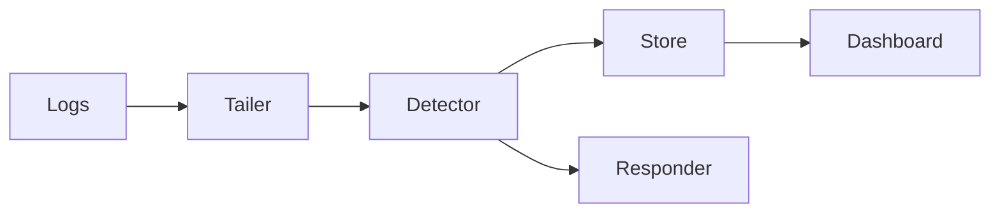

# Homelab Log Auditor — Real-Time Mini-SIEM & Active IPS

## System Architecture

Lightweight, production-hardened Intrusion Detection & Prevention System (Mini-SIEM & Active IPS) with real-time web observability, written in **pure Python** (standard library only, zero external dependencies).

## Key Capabilities & Architecture

- **`engine/config.py` & `config.json`**: External JSON configuration loader with regex validation (`(?P<ip>...)`) and zero-downtime live rule reloading via POSIX `SIGHUP`.
- **`engine/tailer.py`**: Continuous multi-file log follower (`tail -F`) resilient to log rotation (`copytruncate` and inode replacement).
- **`engine/detector.py`**: Multi-vector detection engine combining built-in signatures, custom regex rules, and sliding-window temporal correlation.
- **`engine/storage.py`**: SQLite persistence layer storing alerts, active bans, and **progressive ban escalation** (`1x` -> `4x` -> `16x`, capped at 7 days) for repeat offenders.
- **`engine/responder.py`**: Active firewall enforcement via Linux `nftables` (with `iptables` fallback), CIDR whitelisting, and `--dry-run` simulation mode.
- **`engine/dashboard.py`**: Multi-threaded HTTP server exposing a real-time observability dashboard (XSS-hardened DOM rendering, security headers) and REST API (`/api/stats`, `/api/alerts`, `/api/bans`, `/api/unban`, `/api/export`).
- **`engine/notifier.py`**: Structured webhook notifications for Discord and Slack.
- **`deploy/homelab-auditor.service` & `Dockerfile`**: Hardened `systemd` unit (`ProtectSystem=strict`, `CAP_NET_ADMIN`) and non-root container image (`USER auditor`).

## Built-in Detection Rules

| Rule ID | Severity | Log Source | Detection Logic |
| :--- | :--- | :--- | :--- |
| `SSH-BRUTE-001` | `HIGH` | SSH (`auth.log`) | Flags *N* failed `password`/`publickey` logins within a configurable sliding window. |
| `WEB-SQLI-002` | `CRITICAL` | HTTP Access Log | Detects SQL Injection payloads (`UNION SELECT`, `OR 1=1`, `SLEEP()`) in request URIs. |
| `WEB-LFI-003` | `HIGH` | HTTP Access Log | Identifies Path Traversal and sensitive file probes (`../`, `/etc/passwd`, `.env`). |
| `WEB-SCAN-004` | `MEDIUM` | HTTP Access Log | Correlates automated vulnerability scanning bursts (`/wp-login.php`, `/phpmyadmin`, `/.git/config`). |
| `CUSTOM-SUDO-005` | `HIGH` | Auth / Custom Log | Example JSON-defined rule matching remote `sudo` authentication failures. |

## Quickstart & CLI Usage

- **Run test suite (12 unit & integration tests):** `make test`
- **Start Web Dashboard (dry-run mode on port 8080):** `make run-web`
- **Start active IPS enforcement on Linux:** `sudo python3 auditor.py --config config.json --enforce --web`
- **Hot-reload rules without restart:** `kill -HUP $(pgrep -f auditor.py)`
- **Print summary or export forensic reports:** `python3 auditor.py --report` / `--export-csv incidents.csv` / `--export-json incidents.json`

## Reproducible Attack Simulation

1. Start the auditor watching temporary simulation logs: `mkdir -p /tmp/sim_logs && touch /tmp/sim_logs/auth.log /tmp/sim_logs/access.log && python3 auditor.py --logs /tmp/sim_logs/auth.log /tmp/sim_logs/access.log --threshold 3 --web`
2. In a second terminal, inject SSH brute-force, SQLi, LFI, scanner bursts, and whitelisted traffic: `make demo`
3. Open `http://127.0.0.1:8080` to inspect live alerts, active bans, and CSV/JSON exports.
