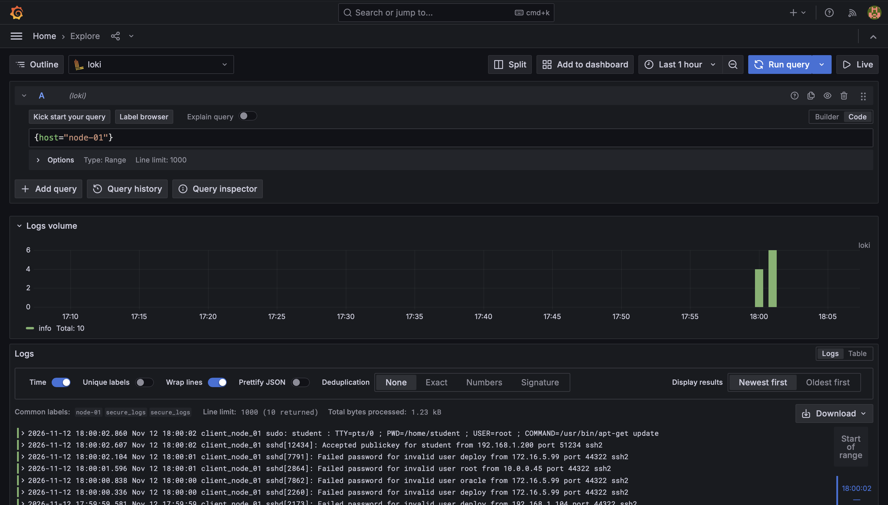

# Linux Log Auditing & Telemetry Pipeline

A lightweight centralized logging setup built to collect, index, and query Linux authentication and system logs across nodes using Promtail, Grafana Loki, and Grafana.

---

## Why I Built This

While running multiple local Linux VMs for coursework and testing, checking `/var/log/auth.log` and `journalctl` meant opening separate SSH sessions for every machine whenever something broke or behaved strangely.

I put this together to learn how log-shipping agents work in practice and to have a single dashboard where I can inspect failed SSH logins, sudo usage, and system events in real time.

---

## Architecture

    [ Target Node (node-01) ]
     └── /var/log/auth.log
          └── Promtail (Agent)
                    │
                    │ HTTP push
                    ▼
    [ Monitoring Host ]
     ├── Grafana Loki  (:3100) — Log ingestion & label indexing
     └── Grafana       (:3000) — Dashboards & LogQL queries

* **Promtail:** Tails `/var/log/auth.log` on the target node and attaches basic metadata labels (`host="node-01"`, `job="secure_logs"`).
* **Grafana Loki:** Stores incoming log streams and indexes only the labels rather than full raw text, keeping memory usage low.
* **Grafana:** Queries Loki over HTTP and displays live logs and rate metrics.

---

## Project Structure

    .
    ├── docker-compose.yml           # Container network and service definitions
    ├── configs/
    │   ├── loki-config.yaml         # Loki storage schema and port settings
    │   └── promtail-config.yaml     # Scrape targets, log paths, and labels
    ├── scripts/
    │   ├── simulate_attack.sh       # Generates sample failed SSH logins and sudo events
    │   └── verify_pipeline.sh       # Checks Loki health and confirms stream ingestion
    └── README.md

---

## Quickstart

### 1. Start the Stack

    docker compose up -d

Check that all four containers are running:

    docker compose ps

### 2. Generate Sample Auth Events
Run the test script to write simulated failed SSH attempts and a sudo command into `node-01`:

    ./scripts/simulate_attack.sh

### 3. Verify Log Delivery
Confirm that Loki is healthy and has indexed the logs from `node-01`:

    ./scripts/verify_pipeline.sh

---

## Grafana Setup & Queries

1. Open `http://localhost:3000` in your browser (`admin` / `admin`).
2. Go to **Connections > Data Sources > Add data source** and pick **Loki**.
3. Set the URL to `http://loki:3100` and click **Save & Test**.
4. Open **Explore**, select the **Loki** data source, and try these LogQL queries:

* **All authentication logs from `node-01`:** `{host="node-01", job="secure_logs"}`
* **Failed SSH password attempts:** `{host="node-01"} |= "Failed password"`
* **Failed login rate per minute:** `rate({host="node-01"} |= "Failed password" [1m])`
* **Executed `sudo` commands:** `{host="node-01"} |= "COMMAND="`

---

## Live Preview

---

## Notes & Takeaways

* **Volume permissions:** Promtail needed read access to `/var/log/auth.log` generated inside the target container, handled by sharing a named volume mounted read-only (`:ro`) on the agent.
* **Label cardinality:** Keeping dynamic values like source IP addresses out of Loki labels avoids index bloat—IPs stay in the raw log line and get filtered via LogQL (`|=`).
