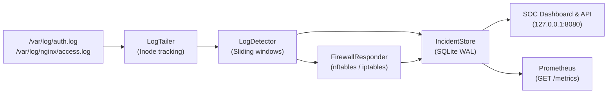

# homelab-log-auditor

[](https://github.com/carolina-queiros/homelab-log-auditor/actions/workflows/ci.yml)

Real-time log monitoring and active intrusion prevention daemon (Mini-SIEM + IPS) written in Python for Linux servers. Tails SSH authentication and web access logs, correlates attack patterns across sliding time windows, enforces progressive firewall bans (`nftables`/`iptables`), persists incidents in SQLite, and exposes Prometheus metrics.

## Architecture



## Detection Rules & Escalation

| Rule | Vector | Condition | Ban Policy (TTL) |
| :--- | :--- | :--- | :--- |
| `SSH-BRUTE-001` | SSH brute-force | >= 5 failed `sshd` attempts in `60s` | 1st: `5m` -> 2nd: `1h` -> 3rd: `24h` (cap `7d`) |
| `WEB-SQLI-002` | SQLi / XSS / LFI | `UNION SELECT`, `OR 1=1`, `<script>`, `../etc/passwd` | Immediate block (`15m` base, exponential backoff) |
| `WEB-SCAN-003` | HTTP enumeration | >= 15 `404`/`403` responses in `30s` | `10m` base (cap `7d`) |

## Security Controls

* **Anti-self-lockout:** Local networks (`127.0.0.0/8`, RFC1918) and configured administrative CIDRs are bypassed prior to any enforcement action.
* **Safe firewall execution:** `nft`/`iptables` commands run via `subprocess.run(..., shell=False)` after strict validation with `ipaddress.ip_address`.
* **Restricted control plane:** The web server binds to `127.0.0.1` by default, sets `Content-Security-Policy` and `X-Frame-Options: DENY` headers, and requires `X-API-Key` on administrative endpoints (`/api/unban`, `/api/export`).
* **Rotation & encoding resilience:** `LogTailer` tracks inode changes across `logrotate` cycles and decodes malformed byte sequences using `errors="replace"`.

## Usage

### Run in simulation mode (--dry-run)
```bash
git clone https://github.com/carolina-queiros/homelab-log-auditor.git
cd homelab-log-auditor

python3 auditor.py --auth-log /var/log/auth.log --web-log /var/log/nginx/access.log --db-path ./data/siem.db --api-key "change-in-production" --dry-run
```

### API & Prometheus Metrics
```bash
curl -s http://127.0.0.1:8080/metrics
curl -H "X-API-Key: change-in-production" http://127.0.0.1:8080/api/export -o incidents.csv
curl -X POST http://127.0.0.1:8080/api/unban -H "Content-Type: application/json" -H "X-API-Key: change-in-production" -d "{"ip": "203.0.113.55"}"
```

### systemd Service
```ini
[Unit]
Description=Homelab Log Auditor
After=network.target nftables.service

[Service]
Type=simple
User=root
WorkingDirectory=/opt/homelab-log-auditor
Environment="SIEM_API_KEY=set-strong-secret"
ExecStart=/usr/bin/python3 /opt/homelab-log-auditor/auditor.py --db-path /var/lib/homelab-siem/siem.db
Restart=always
RestartSec=3

[Install]
WantedBy=multi-user.target
```

## Structure & Tests

```text
homelab-log-auditor/
├── engine/
│   ├── config.py        # Runtime config, thresholds, and CIDR whitelists
│   ├── tailer.py        # Continuous log reader with logrotate detection
│   ├── detector.py      # Rule engine and sliding time windows
│   ├── responder.py     # nftables/iptables integration and TTL escalation
│   ├── storage.py       # SQLite persistence (incidents and active bans)
│   └── dashboard.py     # HTTP server, REST API, CSV export, and /metrics
├── tests/
│   └── test_detector_and_ips.py  # 22 unit, concurrency, and security tests
├── auditor.py           # CLI entrypoint
└── Makefile             # lint and test targets
```

```bash
make lint && make test
```
